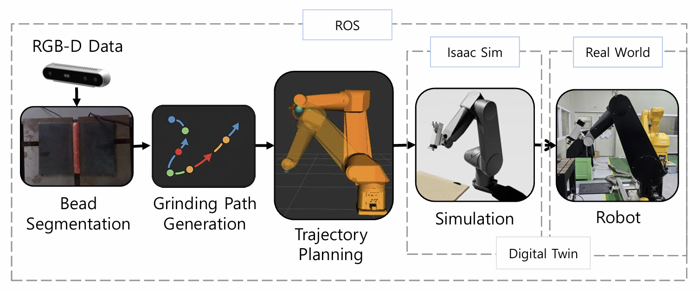
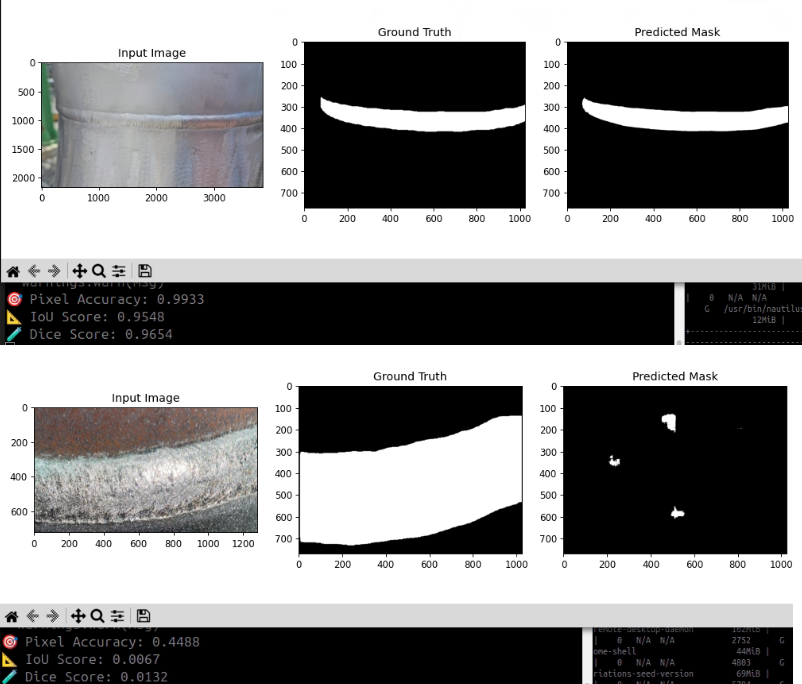
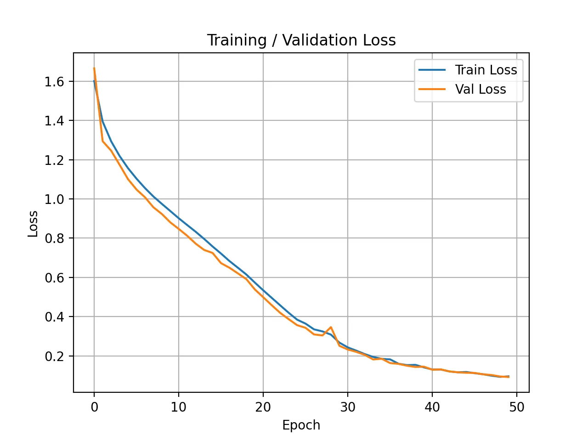
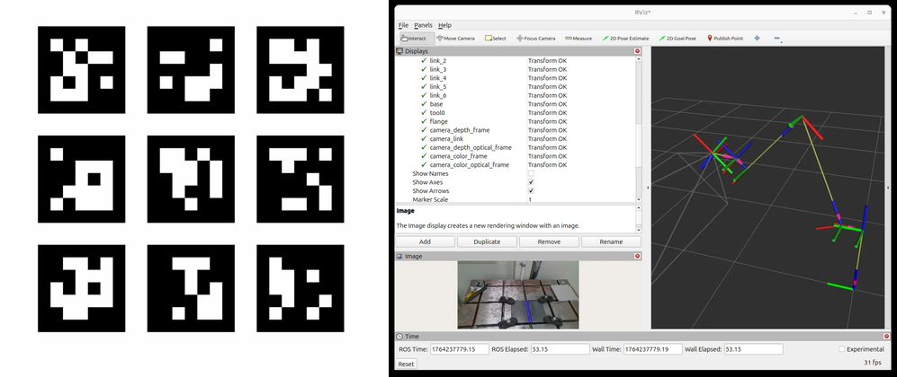
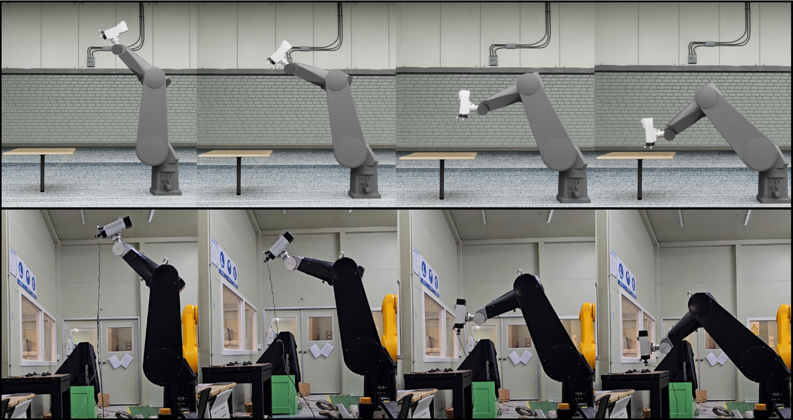
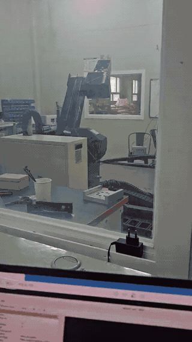
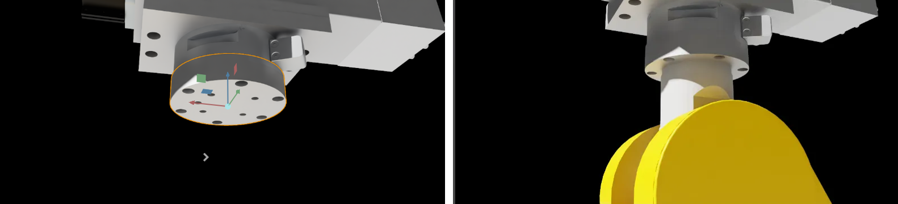
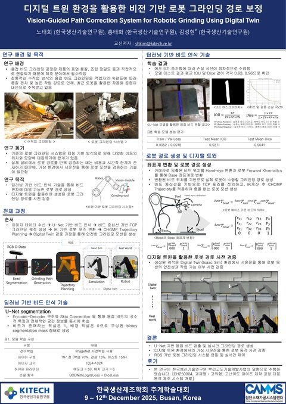

# 디지털 트윈 기반 비전 로봇 그라인딩 경로 생성

**연구실 과제 – 디지털 트윈을 이용한 로봇 원격 가공** (2025.07 ~ 2025.12, 한국생산기술연구원)
<br><sub>한국생산기술연구원 뿌리고도화기술개발사업 「고위험, 고난이도 파이프 제작 공정 대응 원격 제조 시스템 개발」(EH250004) 참여 · 후속 과제 → [bead-grinding-system](https://github.com/shfo2277/bead-grinding-system)</sub>

기존 용접 비드 그라인딩은 미리 티칭한 고정 경로를 반복하기 때문에, 비드 위치나 형상이 바뀌면 경로를 다시 잡아야 합니다.
이 프로젝트는 **RGB-D 카메라로 비드를 인식해 로봇 좌표계의 3D 그라인딩 경로를 만들고**, 실제 로봇(Stäubli RX160)과 동기화된
**Isaac Sim 디지털 트윈**에서 확인한 뒤 실로봇에 적용하는 파이프라인을 구축했습니다.

> 📄 노태희 외, 「디지털 트윈 환경을 활용한 비전 기반 로봇 그라인딩 경로 보정」, 2025 한국생산제조학회 추계학술대회 (2025.12, 제1저자 포스터 발표) · [포스터 보기](docs/poster.jpg) · [초록](#학회-발표)

<p align="center">
  <br>
  <sub>실제 로봇 ↔ Isaac Sim 디지털 트윈 동기화 (왼쪽: Isaac Sim / 오른쪽: 실제 Stäubli RX160, 동시 촬영) · <a href="docs/sim2real_sync.mp4">원본 영상(MP4)</a></sub>
</p>

## 핵심 결과

- **비드 인식**: 공개 데이터 → 데이터 정제 → 실제 환경 전이학습의 3단계 개선, 최종 Test IoU **0.93** / Dice **0.96** (197장)
- **3D 경로 생성**: 비드 mask + depth → 로봇 base 좌표 3D 점 → PCA 주방향 웨이포인트 30개 → MoveIt(CHOMP) 궤적
- **디지털 트윈**: 실제 로봇 `/joint_states`를 Isaac Sim이 실시간으로 받아 같은 자세로 동작
- **실로봇 정합**: 약 **78 mm Z 오차**를 좌표 기준·펜던트 입력·TF/TCP offset 순으로 추적해 보정

## 시스템 구성

<p align="center">
  
</p>

| 실행 영역 | 환경 | 역할 |
| --- | --- | --- |
| Host | Ubuntu 24.04 / ROS 2 Jazzy | Isaac Sim 디지털 트윈, 브릿지 |
| Docker 1 | Ubuntu 20.04 / ROS 1 Noetic | MoveIt, Stäubli VAL3 드라이버, 로봇 제어 |
| Docker 2 | Ubuntu 22.04 / ROS 2 Humble | PyTorch U-Net 추론, 3D 경로 생성 |

## 1. 비드 세그멘테이션 – 3단계 개선 · `BeadTrain/`

<table>
  <tr>
    <th width="33%">① 공개 데이터 학습</th>
    <th width="33%">② 데이터 정제 · 증강</th>
    <th width="33%">③ 실제 환경 전이학습 (최종)</th>
  </tr>
  <tr>
    <td align="center"></td>
    <td align="center"></td>
    <td align="center"></td>
  </tr>
  <tr>
    <td><sub>AI-Hub 용접 비드 데이터로 학습. 비슷한 이미지는 IoU 0.95였지만, 처음 보는 배경·재질에서는 <b>IoU 0.0067</b>로 인식 실패</sub></td>
    <td><sub>프로젝트 시편과 다른 이미지 제거, 실제 시편 라벨링 추가, 이진 분할·Dropout·증강 적용. Test IoU <b>0.90</b>까지 올랐지만 실제 시편에서는 <b>모서리까지 비드로 오인식</b></sub></td>
    <td><sub>D415로 실제 작업 환경을 직접 촬영해 ImageNet 사전학습 인코더를 전이학습. <b>비드만 분리</b></sub></td>
  </tr>
</table>

②의 테스트셋은 학습 데이터와 같은 분포라 현장 성능을 대표하지 못했습니다(도메인 차이). 그래서 ③에서 학습 데이터를 실제 카메라·조명·배경으로 바꾸고 전이학습을 적용한 것이 핵심 개선입니다.

<details>
<summary>최종 모델 학습 설정 · 결과</summary>

| 항목 | 내용 |
| --- | --- |
| 모델 | `segmentation_models_pytorch` U-Net, ResNet34 (ImageNet 사전학습) |
| 입력 / 데이터 | 1024×1024 / D415로 직접 촬영·라벨링(CVAT)한 197장, random 70/15/15 (seed 42) |
| 증강 | HorizontalFlip, ShiftScaleRotate, BrightnessContrast, GaussNoise, MotionBlur |
| 손실 / 최적화 | BCEWithLogitsLoss(pos_weight=2) + Dice / Adam 1e-4, ReduceLROnPlateau, EarlyStopping(patience 7) |
| 판정 threshold | 0.5 |

| 모델 | 데이터 | Test IoU | Test Dice |
| --- | --- | --- | --- |
| `1124unet.pth` | 직접 촬영 이미지 | 0.9462 | 0.9723 |
| `1125unet.pth` (ROS 노드에 사용) | 직접 촬영 이미지 | 0.9408 | 0.9692 |
| `1127unet.pth` | 라벨링 추가, 총 197장 | 0.9311 | 0.9641 |

<p align="center"><br><sub>학습 / 검증 손실 곡선 (최종 Train 0.0952 / Val 0.0918)</sub></p>
</details>

## 2. 3D 그라인딩 경로 생성 · `bead_pose_node.py`

<table>
  <tr>
    <td align="center"><br><sub>로봇 카메라 실시간 비드 인식 (<code>/bead/overlay</code>)</sub></td>
    <td align="center"><br><sub>RViz – 인식한 비드를 로봇 좌표계로 변환한 그라인딩 경로(흰색)</sub></td>
  </tr>
</table>

- 1024×1024 추론 mask를 원본·depth 해상도로 복원한 뒤, 같은 픽셀의 depth와 카메라 intrinsic으로 3D 점 역투영
- 고정 스캔 자세의 `base_link → tool0`와 핸드-아이 결과 `tool0 → camera`를 곱한 변환으로 `base_link` 좌표 변환
- **XY 평면 PCA 주방향**을 따라 웨이포인트 30개 생성 (Z는 평균값, 유효 depth 점 최대 5000개 샘플링)
- 웨이포인트에 대해 IK를 풀고 MoveIt의 **CHOMP** planning으로 궤적 계획

## 3. 핸드-아이 캘리브레이션 · `Calibration/handeye_calib_node.py`

<p align="center">
  <br>
  <sub>직접 만든 ArUco GridBoard (왼쪽) · RViz에서 base → tool0 → camera TF 연결 확인 (오른쪽)</sub>
</p>

D415를 로봇 끝에 장착한 상태에서 ArUco GridBoard(3×3, 마커 4 cm, 간격 1 cm)를 여러 자세로 촬영하고(목표 20개), `base_link → tool0` TF와 보드 자세로 OpenCV TSAI 방식의 `tool0 → camera` 변환을 계산했습니다.

## 4. 디지털 트윈 · 실제 로봇 연동

<p align="center">
  <br>
  <sub>디지털 트윈(위)과 실제 로봇(아래)의 같은 자세 비교</sub>
</p>

<table>
  <tr>
    <td align="center" width="40%"><br><sub>MoveIt(RViz)으로 계획한 궤적을 실제 RX160이 실행 (2배속) · <a href="docs/moveit_real_robot.mp4">MP4</a></sub></td>
    <td align="center"><br><sub>그라인더 엔드이펙터를 로봇 TCP에 정렬 – 어댑터 기준 좌표계 생성(왼쪽) → 중심 차이(Δ)를 계산해 그라인더 위치 보정(오른쪽)</sub></td>
  </tr>
</table>

**로봇 통신** – 오픈소스 [staubli_val3_driver](https://github.com/ros-industrial/staubli_val3_driver)의 VAL3 `ros_server`를 RX160 컨트롤러에 배포했습니다.
컨트롤러가 TCP 서버 2개(Motion 11000 / Feedback 11002)를 열고, PC의 ROS 1 `industrial_robot_client`가 simple_message 프로토콜로 접속해
관절 상태를 받고(약 50 Hz) MoveIt 궤적을 `FollowJointTrajectory`로 전달합니다. 같은 관절 상태가 브릿지를 거쳐 Isaac Sim 디지털 트윈에도 반영됩니다.

## 5. 실로봇 경로 정합 – 78 mm Z 오차

비전으로 만든 경로를 실제 RX160에 처음 적용했을 때, 경로와 실제 로봇 작업 좌표 사이에 **Z축 약 78 mm 오차**가 있었습니다.

| 추적 순서 | 확인한 것 |
| --- | --- |
| 1. 좌표 기준 | ROS TF와 티치 펜던트 좌표를 비교해 약 550 mm 기준 offset 진단 → URDF `base_link`(설치면)와 Stäubli 기준 좌표계(J2 어깨 축 높이)의 원점 차이 |
| 2. 펜던트 입력 | 펜던트에서 입력·확인한 좌표가 어느 기준(플랜지 / TCP)인지 확인 |
| 3. TF · TCP offset | 카메라 → tool0 → TCP로 이어지는 변환 체인과 그라인더 TCP offset 점검 |

→ 좌표 변환 체인과 TCP·펜던트 기준을 맞춰 실로봇 경로 정합을 확보했습니다.

## 트러블슈팅

| 문제 | 원인 | 해결 |
| --- | --- | --- |
| 컨트롤러에 `ros_server` 배포 실패 | FTP 업로드 시 파일 시스템 권한·경로 오류, TCP 서버 이름 불일치 | maintenance 계정으로 `/usr/usrapp`에 업로드, 컨트롤러 TCP 서버(EOS 13, Nagle Off, Timeout −1) 설정 후 SRS로 로드·실행 |
| ROS 1 → ROS 2로 토픽이 넘어오지 않음 | Noetic–Foxy 브릿지의 DDS 설정·Domain ID 불일치, Foxy와 호스트 Jazzy 간 타입 해시 호환 문제 | Domain ID 통일 후 **Noetic ↔ Jazzy 브릿지를 소스 빌드**해 직접 연결 |
| MoveIt 계획은 되는데 실제 로봇이 움직이지 않음 | 드라이버와 MoveIt의 컨트롤러 이름 불일치, 궤적 시간(`time_from_start`)이 모두 0 | 컨트롤러 이름 매핑, IPTP 시간 파라미터화 적용 → 목표 위치까지 이동 확인 |
| Isaac Sim에서 로봇이 쓰러진 채 움직임 ([GIF](docs/isaac_articulation_issue.gif)) | 루트 프림이 Articulation Root가 아니고, 링크에 Rigid Body/Collider가 없음 | Articulation Root 지정, Rigid Body 설정, 베이스를 월드에 고정 |
| GPU 추론 노드를 호스트 ROS 2에서 실행할 수 없음 | 당시 구축한 RTX 5070용 PyTorch nightly 환경(Python 3.10)과 Jazzy의 rclpy(Python 3.12)를 한 프로세스에서 쓸 수 없음 | 비전 노드만 **ROS 2 Humble(Python 3.10) + PyTorch 컨테이너**로 분리 |

## 학회 발표

<table>
  <tr>
    <td width="300" align="center"><a href="docs/poster.jpg"></a><br><sub>클릭하면 포스터 원본</sub></td>
    <td>
      <b>디지털 트윈 환경을 활용한 비전 기반 로봇 그라인딩 경로 보정</b><br>
      <i>Vision-Guided Path Correction System for Robotic Grinding Using Digital Twin</i><br>
      노태희(제1저자), 홍태화, 김성현(교신) · 한국생산기술연구원<br>
      2025 한국생산제조학회 추계학술대회, 2025.12.9 ~ 12.12, 부산<br><br>
      <sub>Key Words: Industrial Robot, Segmentation, U-Net Algorithm, Remote Control</sub>
    </td>
  </tr>
</table>

<details>
<summary>초록</summary>

최근 산업용 로봇을 활용한 용접 비드 그라인딩 공정에 대한 수요가 증가하고 있다. 전통적인 용접 비드 그라인딩 공정은 수작업 비중이 높아 작업 효율이 낮고 생산성이 떨어진다. 이에 따라 산업용 로봇 자동화 방식이 많이 도입되고 있다. 그러나 기존 시스템은 사전에 설정된 고정 경로를 반복 수행하는 방식으로, 비드의 위치와 높이 변화를 인식하지 못하고 작업 위치가 달라질 경우 작업자가 수동으로 위치를 수정해야 한다. 따라서 본 연구에서는 이러한 한계를 극복하기 위해 비전 인식과 디지털 트윈 기반 경로 보정 기법을 결합한 로봇 그라인딩 자동화 시스템을 제안한다. 제안된 모델은 U-Net 기반 세그멘테이션 모델을 활용하여 용접 비드의 형상과 위치를 정확하게 인식하고, 로봇 좌표계 기준으로 로봇 공구 경로를 생성하였다. 제안된 시스템의 타당성을 검증하기 위해 NVIDIA Isaac Sim 기반의 디지털 트윈 환경을 구축하여 시뮬레이션을 수행하였다. 시뮬레이션 환경에서는 다양한 형상과 위치의 용접 비드에 대한 비전 인식 및 경로 생성 알고리즘의 성능을 검증하였으며, ROS 기반 인터페이스를 통해 실시간 경로 보정이 가능함을 확인하였다. 시뮬레이션 검증을 통해 최적화된 알고리즘을 실제 산업용 로봇 시스템에 적용하여 실험을 수행하였으며, 제안된 시스템이 비드 형상 변화에 능동적으로 대응하여 안정적인 그라인딩 작업을 수행함을 실증하였다.
</details>

## 한계 및 개선 방향

- 접촉 가공인데 힘 제어가 없음 → Force/Torque 센서 기반 impedance·admittance 제어
- 평면·직선 비드 가정(XY PCA, 평균 Z) → 곡면은 국소 표면 법선·곡선 피팅 필요, PCA 방향 부호도 기준축으로 고정 필요
- 이미지 단위 random split → 새 시편 일반화를 보려면 시편·세션 단위 split 평가 필요

## 파일 구성

```
├── BeadTrain/           U-Net 학습 (bead_train.py, bead_train_end.py), 라벨 변환
├── BEADdetect/          비드 인식(bead_unet_node.py) · 시각화 ROS 2 노드, launch 파일
├── Calibration/         ArUco GridBoard 핸드-아이 캘리브레이션 노드
├── bead_pose_node.py    mask + depth → 3D 그라인딩 경로 생성
└── docs/                README 이미지 · 영상
```

**개발 환경**: Stäubli RX160 · Intel RealSense D415 · Ubuntu 24.04 · ROS 1 Noetic / ROS 2 Jazzy·Humble · MoveIt (CHOMP) · NVIDIA Isaac Sim 5.0 · RTX 5070 (CUDA 12.8) · PyTorch

> 학습 데이터와 모델 가중치(`*.pth`)는 저장소에 포함되어 있지 않습니다.

## 후속 프로젝트

이 시스템을 확장해, 가공 후 재스캔으로 완료 영역을 인식하고 추가 가공 또는 정지를 판단하는 폐루프 그라인딩 자동화를 구현했습니다.
→ [bead-grinding-system](https://github.com/shfo2277/bead-grinding-system)
