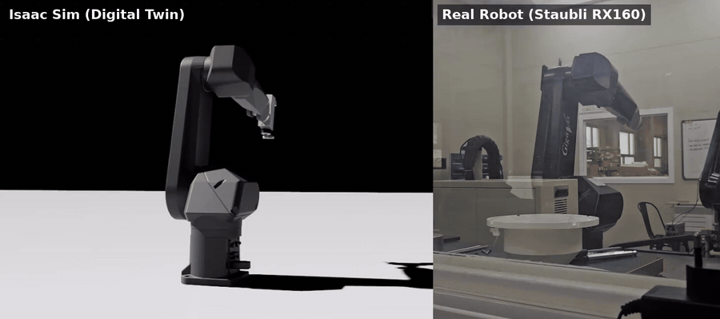
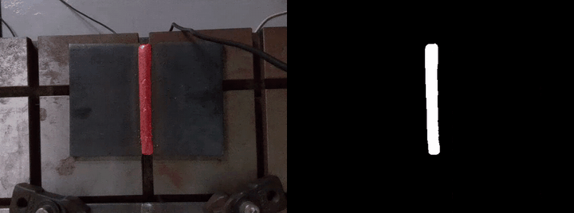
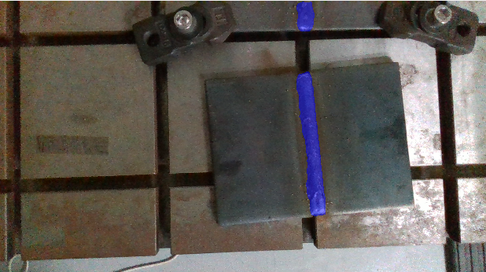
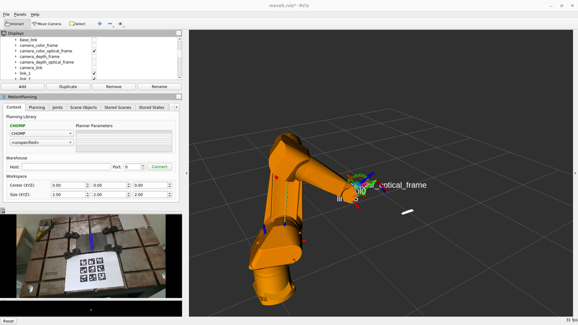
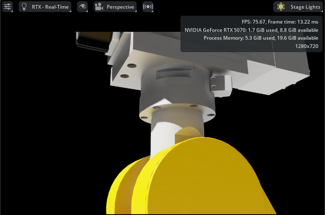
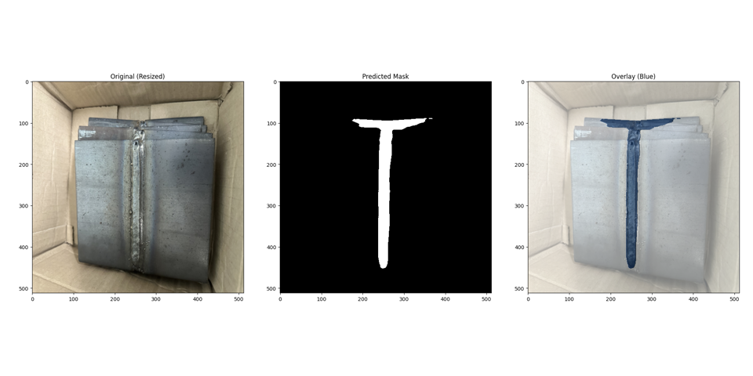

# 디지털 트윈 기반 비전 로봇 그라인딩 경로 생성

**연구실 과제 – 디지털 트윈을 이용한 로봇 원격 가공** (2025.07 ~ 2026.02)

기존 용접 비드 그라인딩은 작업자가 미리 티칭한 고정 경로를 반복하기 때문에, 작업물 위치나 비드 형상이 바뀌면 그대로 쓸 수 없습니다.
이 프로젝트는 **카메라로 실제 비드를 인식해 그 비드에 맞는 3D 그라인딩 경로를 만들고**, 실제 로봇(Staubli RX160)과 동기화된
**Isaac Sim 디지털 트윈**에서 동작을 확인한 뒤 MoveIt으로 로봇을 움직이는 시스템을 구축했습니다.

<p align="center">
  <br>
  <sub>실제 로봇 ↔ Isaac Sim 디지털 트윈 동기화 (왼쪽: Isaac Sim / 오른쪽: 실제 Staubli RX160, 동시 촬영) · <a href="docs/sim2real_sync.mp4">원본 영상(MP4)</a></sub>
</p>

```
 RealSense D415 ─▶ U-Net 비드 세그멘테이션 ─▶ Depth로 3D 점 복원 ─▶ 핸드-아이 변환(카메라 → 로봇 base)
   (RGB-D)                                                                       │
                                                                                 ▼
 Staubli RX160 ◀── MoveIt (ROS 1) ◀── ros1_bridge ◀── PCA 기반 그라인딩 경로 (웨이포인트 30개)
       │
       └── /joint_states ──▶ ros1_bridge ──▶ Isaac Sim (ROS 2 OmniGraph) : 실제 로봇 자세를 실시간으로 따라 움직이는 디지털 트윈
```

## 결과

<p align="center">
  <br>
  <sub>전이학습 모델로 실제 카메라 영상에서 비드 인식 (왼쪽: 오버레이 / 오른쪽: 예측 마스크)</sub>
</p>

<table>
  <tr>
    <td align="center"><br><sub>로봇 카메라 실시간 비드 인식 (<code>/bead/overlay</code>)</sub></td>
    <td align="center"><br><sub>RViz – 인식한 비드를 로봇 좌표계로 변환한 그라인딩 경로(흰색)</sub></td>
  </tr>
  <tr>
    <td align="center"><br><sub>Isaac Sim 디지털 트윈 – 로봇 끝단에 그라인더 엔드이펙터 정렬</sub></td>
    <td align="center"><br><sub>[개선 전] U-Net 비드 세그멘테이션 – 시편 윗변 모서리까지 비드로 오인식 (원본 / 예측 마스크 / 오버레이)</sub></td>
  </tr>
</table>

## 주요 내용

**1. 비드 세그멘테이션 모델** – `BeadTrain/`
- `segmentation_models_pytorch` U-Net (ResNet34, ImageNet 사전학습), BCE + Dice 손실
- `bead_train.py` – 그라인딩 전 비드 학습 (입력 1024) / `bead_train_end.py` – 그라인딩 후 비드 학습 (입력 1280, 비율 유지 패딩)
- 초기에는 AI-Hub 용접 비드 공개 데이터로 모델을 실험했고, 최종 모델은 ImageNet 사전학습 인코더를 **실제 시편을 직접 촬영·라벨링한 이미지로 전이학습**
- 회전·이동, 밝기/대비, 노이즈, 모션 블러 증강 / pos_weight 적용 BCE + Dice / ReduceLROnPlateau
- 전이학습 결과 (Train 70% · Val 15% · Test 15% 분할, 50 epoch)

  | 모델 | 데이터 | Test IoU | Test Dice |
  | --- | --- | --- | --- |
  | `1124unet.pth` | 직접 촬영 이미지 | 0.9462 | 0.9723 |
  | `1125unet.pth` (ROS 노드에 사용) | 직접 촬영 이미지 | 0.9408 | 0.9692 |
  | `1127unet.pth` | 라벨링 추가, 총 197장 | 0.9311 | 0.9641 |

**2. 비드 인식 ROS 2 노드** – `BEADdetect/`
- `bead_unet_node.py` – 카메라 영상 → U-Net → `/bead/mask`, `/bead/overlay` 발행
- `bead_visualizer_node.py` – 마스크 외곽선을 RViz 마커로 표시

**3. 3D 그라인딩 경로 생성** – `bead_pose_node.py`
- 비드 마스크 + depth → 카메라 3D 좌표 → `base_link → tool0 → camera` 변환 행렬로 로봇 좌표계 변환
- 비드 점들의 **PCA 주방향**으로 시작점·끝점을 구하고, 그 직선을 따라 웨이포인트 30개 생성
- `/bead/grind_path_base`(Path), 시작/끝 Pose, RViz 마커, 포인트클라우드 발행

**4. 핸드-아이 캘리브레이션** – `Calibration/handeye_calib_node.py`
- 직접 만든 ArUco GridBoard(3×3, 마커 4 cm, 간격 1 cm)를 여러 로봇 자세에서 촬영
- TF(`base_link → tool0`)와 보드 자세로 `cv2.calibrateHandEye`(TSAI) 계산 → `tool0 → camera` 변환

**5. 실제 로봇 ↔ 디지털 트윈 연동** (코드 외 환경 구성)
- ROS 1 Noetic 컨테이너에서 Staubli VAL3 드라이버 + MoveIt 실행, 실제 RX160 제어
- `ros1_bridge`로 ROS 1 ↔ ROS 2 연결, Isaac Sim이 `/joint_states`를 구독해 실제 로봇 자세를 실시간으로 반영
- 로봇 URDF, D415 카메라, 그라인더 엔드이펙터(CAD)를 Isaac Sim에 임포트하고 TCP 정렬

## 파일 구성

```
├── BeadTrain/              U-Net 학습 (bead_train.py, bead_train_end.py), 라벨 변환, 데이터 정리
├── BEADdetect/             비드 인식 · 시각화 ROS 2 노드, launch 파일
├── Calibration/            ArUco 보드 핸드-아이 캘리브레이션 노드
├── bead_pose_node.py       마스크 + depth → 3D 그라인딩 경로 생성
├── bead_detect.py          U-Net + depth 비드 위치 추정 (초기 버전)
├── test_grindingend.py     그라인딩 후 비드 인식 모델 실시간 테스트 (RealSense 직접 연결)
├── evaluation.py           모델 평가
├── camera*.py              학습용 이미지 · 영상 촬영
├── camera_test_node.py     카메라 TF 확인
└── 기타/                    해상도 · 픽셀 확인, GPU 체크, 시편 촬영 영상
```

## 개발 환경

| 구분 | 내용 |
| --- | --- |
| 로봇 | Staubli RX160 (VAL3 드라이버, MoveIt) |
| 카메라 | Intel RealSense D415 (RGB-D) |
| 호스트 | Ubuntu 24.04, ROS 2 Jazzy, NVIDIA Isaac Sim 5.0, RTX 5070 (CUDA 12.8) |
| 컨테이너 | ROS 1 Noetic (로봇 드라이버 · MoveIt), ROS 2 Humble + PyTorch (U-Net 추론) |
| 통신 | ros1_bridge (ROS 1 ↔ ROS 2) |
| 딥러닝 | PyTorch, segmentation_models_pytorch, albumentations, OpenCV |

> 학습 데이터와 모델 가중치(`*.pth`)는 저장소에 포함되어 있지 않습니다.

## 후속 프로젝트

이 과제에서 만든 비드 인식 · 경로 생성 · 캘리브레이션을 바탕으로, 그라인딩 후 재스캔으로 연삭 종료를 자동 판정하는 시스템으로 확장했습니다.
→ [bead-grinding-system](https://github.com/shfo2277/bead-grinding-system)
