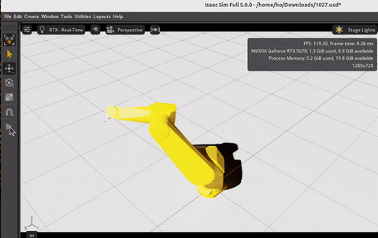

# 디지털 트윈 기반 비전 로봇 그라인딩 경로 생성

**연구실 과제 – 디지털 트윈을 이용한 로봇 원격 가공** (2025.07 ~ 2026.02, 한국생산기술연구원)

기존 용접 비드 그라인딩은 작업자가 미리 티칭한 고정 경로를 반복하기 때문에, 작업물 위치나 비드 형상이 바뀌면 그대로 쓸 수 없습니다.
이 프로젝트는 **카메라로 실제 비드를 인식해 그 비드에 맞는 3D 그라인딩 경로를 만들고**, 실제 로봇(Staubli RX160)과 동기화된
**Isaac Sim 디지털 트윈**에서 동작을 확인한 뒤 MoveIt으로 로봇을 움직이는 시스템을 구축했습니다.

> 📄 노태희 외, 「디지털 트윈 환경을 활용한 비전 기반 로봇 그라인딩 경로 보정」, 2025 한국생산제조학회 추계학술대회 (2025.12, 제1저자 포스터 발표)

<p align="center">
  <br>
  <sub>실제 로봇 ↔ Isaac Sim 디지털 트윈 동기화 (왼쪽: Isaac Sim / 오른쪽: 실제 Staubli RX160, 동시 촬영) · <a href="docs/sim2real_sync.mp4">원본 영상(MP4)</a></sub>
</p>

## 핵심 결과

- **비드 인식**: 공개 데이터 → 데이터 정제 → 실제 환경 전이학습의 3단계 개선, 최종 Test IoU **0.93 ~ 0.95** / Dice **0.96 ~ 0.97**
- **핸드-아이 캘리브레이션**: 35개 자세 중 이상치를 걸러 28개 사용, 잔차 평균 **0.73 mm** (중앙값 0.55 mm)
- **디지털 트윈**: 실제 로봇 `/joint_states`를 Isaac Sim이 실시간으로 받아 같은 자세로 동작
- **경로 오차 분석**: 로봇 좌표 기준 차이(**550 mm**)와 TCP 정의를 단계별로 검증해 원인 분리

## 시스템 구성

<p align="center">
  <br>
  <sub>RGB-D 입력 → 비드 세그멘테이션 → 그라인딩 경로 생성 → 궤적 계획 → 디지털 트윈 검증 → 실제 로봇</sub>
</p>

<details>
<summary>데이터 흐름 (텍스트)</summary>

```
 RealSense D415 ─▶ U-Net 비드 세그멘테이션 ─▶ Depth로 3D 점 복원 ─▶ 핸드-아이 변환(카메라 → 로봇 base)
   (RGB-D)                                                                       │
                                                                                 ▼
 Staubli RX160 ◀── MoveIt (ROS 1) ◀── ros1_bridge ◀── PCA 기반 그라인딩 경로 (웨이포인트 30개)
       │
       └── /joint_states ──▶ ros1_bridge ──▶ Isaac Sim (ROS 2 OmniGraph) : 실제 로봇 자세를 실시간으로 따라 움직이는 디지털 트윈
```
</details>

## 1. 비드 세그멘테이션 – 3단계 개선 · `BeadTrain/`

<table>
  <tr>
    <th width="33%">① 공개 데이터 학습</th>
    <th width="33%">② 데이터 정제 · 증강</th>
    <th width="33%">③ 실제 환경 전이학습 (최종)</th>
  </tr>
  <tr>
    <td align="center"></td>
    <td align="center"></td>
    <td align="center"></td>
  </tr>
  <tr>
    <td><sub>AI-Hub 용접 비드 데이터로 학습. 비슷한 이미지는 IoU 0.95였지만, 처음 보는 배경·재질에서는 <b>IoU 0.0067</b>로 인식 실패</sub></td>
    <td><sub>프로젝트 시편과 다른 이미지 제거, 실제 시편 라벨링 추가, 이진 분할·Dropout·증강 적용. Test IoU <b>0.90</b>까지 올랐지만 실제 시편에서는 <b>모서리까지 비드로 오인식</b></sub></td>
    <td><sub>D415로 실제 작업 환경을 직접 촬영해 ImageNet 사전학습 인코더를 전이학습. <b>비드만 분리</b></sub></td>
  </tr>
</table>

②의 테스트셋은 학습 데이터와 같은 분포라 현장 성능을 대표하지 못했습니다(도메인 차이). 그래서 ③에서 학습 데이터를 실제 카메라·조명·배경으로 바꾸고 전이학습을 적용한 것이 핵심 개선입니다.

- `segmentation_models_pytorch` U-Net (ResNet34, ImageNet 사전학습), BCE + Dice 손실
- `bead_train.py` – 그라인딩 전 비드 학습 (입력 1024) / `bead_train_end.py` – 그라인딩 후 비드 학습 (입력 1280, 비율 유지 패딩)
- 라벨링: CVAT 폴리곤 라벨링 → 이진 마스크 변환
- 회전·이동, 밝기/대비, 노이즈, 모션 블러 증강 / pos_weight 적용 BCE + Dice / ReduceLROnPlateau
- 전이학습 결과 (Train 70% · Val 15% · Test 15% 분할, 50 epoch)

  | 모델 | 데이터 | Test IoU | Test Dice |
  | --- | --- | --- | --- |
  | `1124unet.pth` | 직접 촬영 이미지 | 0.9462 | 0.9723 |
  | `1125unet.pth` (ROS 노드에 사용) | 직접 촬영 이미지 | 0.9408 | 0.9692 |
  | `1127unet.pth` | 라벨링 추가, 총 197장 | 0.9311 | 0.9641 |

<p align="center">
  <br>
  <sub>학습 / 검증 손실 곡선 (최종 Train 0.0952 / Val 0.0918)</sub>
</p>

**비드 인식 ROS 2 노드** – `BEADdetect/`
- `bead_unet_node.py` – 카메라 영상 → U-Net → `/bead/mask`, `/bead/overlay` 발행
- `bead_visualizer_node.py` – 마스크 외곽선을 RViz 마커로 표시

## 2. 3D 그라인딩 경로 생성 · `bead_pose_node.py`

<table>
  <tr>
    <td align="center"><br><sub>로봇 카메라 실시간 비드 인식 (<code>/bead/overlay</code>)</sub></td>
    <td align="center"><br><sub>RViz – 인식한 비드를 로봇 좌표계로 변환한 그라인딩 경로(흰색)</sub></td>
  </tr>
</table>

- 비드 마스크 + depth → 카메라 3D 좌표 → `base_link → tool0 → camera` 변환 행렬로 로봇 좌표계 변환
- 비드 점들의 **PCA 주방향**으로 시작점·끝점을 구하고, 그 직선을 따라 웨이포인트 30개 생성
- 웨이포인트를 역기구학으로 관절 각도로 변환한 뒤 **CHOMP**로 충돌을 피하는 부드러운 궤적 생성
- `/bead/grind_path_base`(Path), 시작/끝 Pose, RViz 마커, 포인트클라우드 발행

## 3. 핸드-아이 캘리브레이션 · `Calibration/handeye_calib_node.py`

<p align="center">
  <br>
  <sub>직접 만든 ArUco GridBoard (왼쪽) · RViz에서 base → tool0 → camera TF 연결 확인 (오른쪽)</sub>
</p>

- ArUco GridBoard (3×3, 마커 4 cm, 간격 1 cm)를 여러 로봇 자세에서 촬영
- TF(`base_link → tool0`)와 보드 자세로 `cv2.calibrateHandEye` 계산 → `tool0 → camera` 변환
- **재캘리브레이션 결과**: 35개 자세 → 이상치 반복 제거 후 28개 사용, 5개 알고리즘 비교, 중앙값 잔차가 가장 작은 TSAI 선택

  | 항목 | 값 |
  | --- | --- |
  | 잔차 (평균 / 중앙값 / 최대) | 0.73 / 0.55 / 1.55 mm |
  | 회전 잔차 평균 | 0.120° |
  | `tool0 → camera` 이동 | (147.2, 11.9, 184.1) mm |
  | 현장 검증 | 로봇 자세 11개에서 측정한 보드 위치 표준편차 약 1 mm 이내 |

## 4. 디지털 트윈 · 실제 로봇 연동

<p align="center">
  <br>
  <sub>디지털 트윈(위)과 실제 로봇(아래)의 같은 자세 비교</sub>
</p>

<table>
  <tr>
    <td align="center" width="40%"><br><sub>MoveIt(RViz)으로 계획한 궤적을 실제 RX160이 실행 (2배속) · <a href="docs/moveit_real_robot.mp4">MP4</a></sub></td>
    <td align="center"><br><sub>그라인더 엔드이펙터를 로봇 TCP에 정렬 – 어댑터 기준 좌표계 생성(왼쪽) → 중심 차이(Δ)를 계산해 그라인더 위치 보정(오른쪽)</sub></td>
  </tr>
</table>

- ROS 1 Noetic 컨테이너에서 Staubli VAL3 드라이버 + MoveIt 실행, 실제 RX160 제어 (관절 값 약 50 Hz 수신)
- `ros1_bridge`로 ROS 1 ↔ ROS 2 연결, Isaac Sim이 ROS 2 OmniGraph로 `/joint_states`를 구독해 실제 로봇 자세를 실시간 반영
- 로봇 URDF, D415 카메라, 그라인더 엔드이펙터(CAD)를 Isaac Sim에 임포트하고 TCP 정렬

## 5. 경로 오차 원인 분석

인식한 비드 위치로 만든 경로가 실제 비드와 **Z축으로 약 78 mm** 어긋나는 문제가 있었습니다. 가능한 원인을 하나씩 분리해 검증했습니다.

| 단계 | 확인한 것 | 결과 |
| --- | --- | --- |
| 1. 좌표 기준 | ROS TF(정기구학)와 티치 펜던트 좌표 비교 | X·Y는 같고 **Z만 550 mm 차이** → URDF `base_link`(설치면)와 Staubli 기준 좌표계(J2 어깨 축 높이)의 원점 차이 |
| 2. 캘리브레이션 | 35개 자세로 재캘리브레이션, 11개 자세에서 보드 위치 반복 측정 | 잔차 평균 0.73 mm, 반복 측정 편차 약 1 mm → **원인 아님** |
| 3. TCP 정의 | 펜던트의 Flange 좌표(플랜지)와 Cartesian 좌표(그라인더 끝, tTool x=125 mm · z=145.4 mm · ry=−90°) 구분 | 좌표 입력 시 기준 혼용 확인 |

→ 오차는 캘리브레이션이 아니라 **펜던트 좌표 입력 오류와 좌표 기준 불일치**에서 발생했습니다.

## 트러블슈팅

| 문제 | 원인 | 해결 |
| --- | --- | --- |
| ROS 1 → ROS 2로 토픽이 넘어오지 않음 | Noetic–Foxy 브릿지는 메시지 매핑은 됐지만 DDS 설정·ROS Domain ID가 달랐고, Foxy와 호스트 Jazzy 간 타입 해시 호환 문제 | Domain ID 통일 후, **Noetic ↔ Jazzy 브릿지를 소스 빌드**해 직접 연결 |
| MoveIt 계획은 되는데 실제 로봇이 움직이지 않음 | 드라이버와 MoveIt의 컨트롤러 이름 불일치, 궤적 시간(`time_from_start`)이 모두 0, 모터 전원·자동 모드 미설정 | 컨트롤러 이름 매핑, IPTP 시간 파라미터화 적용, 속도 제한 조정 → 목표 위치까지 이동 확인 |
| Isaac Sim에서 로봇이 쓰러진 채 움직임 (아래) | 루트 프림이 Articulation Root가 아니고, 링크에 Rigid Body/Collider가 없음 | Articulation Root 지정, Rigid Body 설정, 베이스를 월드에 고정 |
| Isaac Sim ROS 2 브릿지가 켜지지 않음 | Isaac Sim 전용 파이썬에 PyTorch가 없거나 버전 불일치 | Isaac Sim 파이썬 환경에 버전을 맞춘 torch 재설치 |
| GPU 추론 노드를 호스트에서 실행할 수 없음 | 호스트 ROS 2 Jazzy는 Python 3.12, RTX 5070용 PyTorch nightly(cu128)는 Python 3.10 휠만 제공 | **ROS 2 Humble + PyTorch 컨테이너**로 비전 노드만 분리 |
| Ubuntu 24.04에서 RealSense 연결 불안정 | 배포 SDK의 24.04 지원 불안정 | librealsense 2.56 소스 빌드 |

<p align="center">
  <br>
  <sub>Articulation 설정 전 – 베이스가 고정되지 않아 로봇이 쓰러진 채 관절 값대로 움직이는 모습</sub>
</p>

## 파일 구성

```
├── BeadTrain/              U-Net 학습 (bead_train.py, bead_train_end.py), 라벨 변환, 데이터 정리
├── BEADdetect/             비드 인식 · 시각화 ROS 2 노드, launch 파일
├── Calibration/            ArUco 보드 핸드-아이 캘리브레이션 노드
├── bead_pose_node.py       마스크 + depth → 3D 그라인딩 경로 생성
├── bead_detect.py          U-Net + depth 비드 위치 추정 (초기 버전)
├── test_grindingend.py     그라인딩 후 비드 인식 모델 실시간 테스트 (RealSense 직접 연결)
├── evaluation.py           모델 평가
├── camera*.py              학습용 이미지 · 영상 촬영
├── camera_test_node.py     카메라 TF 확인
├── docs/                   README 이미지 · 영상
└── 기타/                    해상도 · 픽셀 확인, GPU 체크, 시편 촬영 영상
```

## 개발 환경

| 구분 | 내용 |
| --- | --- |
| 로봇 | Staubli RX160 (VAL3 드라이버, MoveIt) |
| 카메라 | Intel RealSense D415 (RGB-D, librealsense 2.56 소스 빌드) |
| 호스트 | Ubuntu 24.04, ROS 2 Jazzy, NVIDIA Isaac Sim 5.0, RTX 5070 (CUDA 12.8) |
| 컨테이너 | ROS 1 Noetic (로봇 드라이버 · MoveIt), ROS 2 Humble + PyTorch (U-Net 추론) |
| 통신 | ros1_bridge (ROS 1 Noetic ↔ ROS 2 Jazzy) |
| 경로 계획 | MoveIt, CHOMP |
| 딥러닝 | PyTorch, segmentation_models_pytorch, albumentations, OpenCV |

> 학습 데이터와 모델 가중치(`*.pth`)는 저장소에 포함되어 있지 않습니다.

## 후속 프로젝트

이 과제에서 만든 비드 인식 · 경로 생성 · 캘리브레이션을 바탕으로, 그라인딩 후 재스캔으로 연삭 종료를 자동 판정하는 시스템으로 확장했습니다.
→ [bead-grinding-system](https://github.com/shfo2277/bead-grinding-system)
